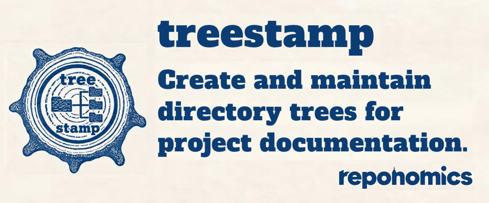
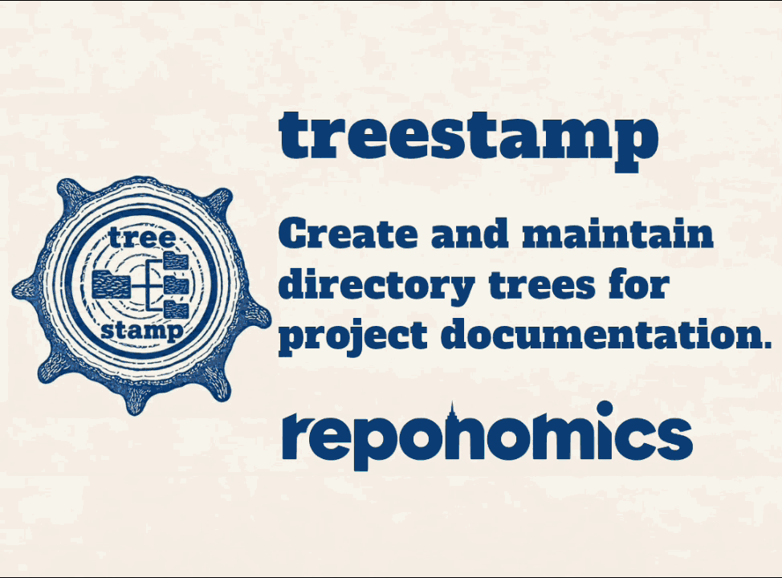
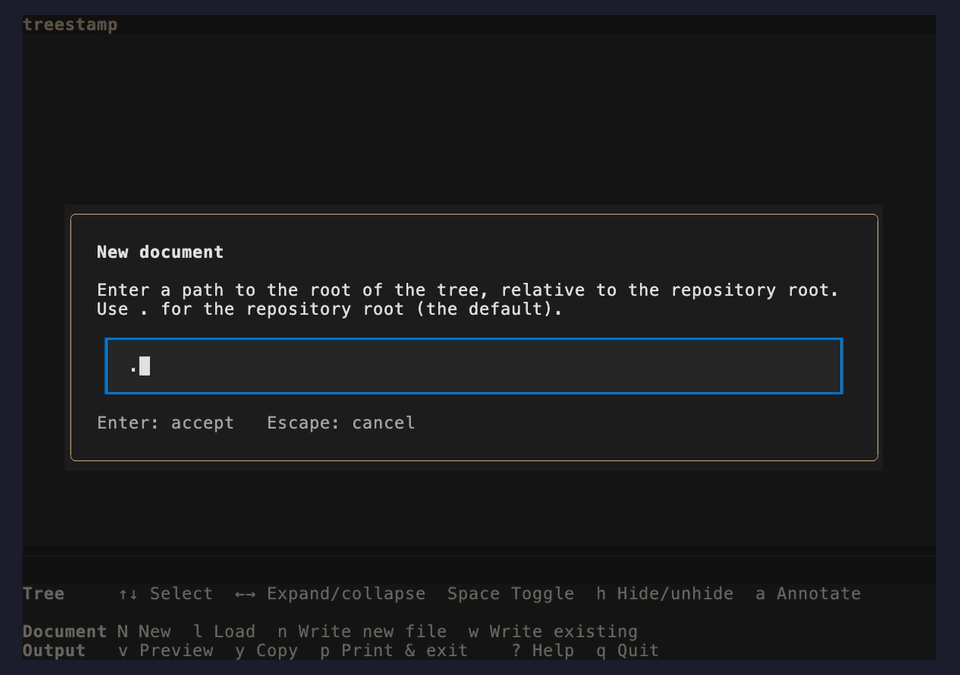
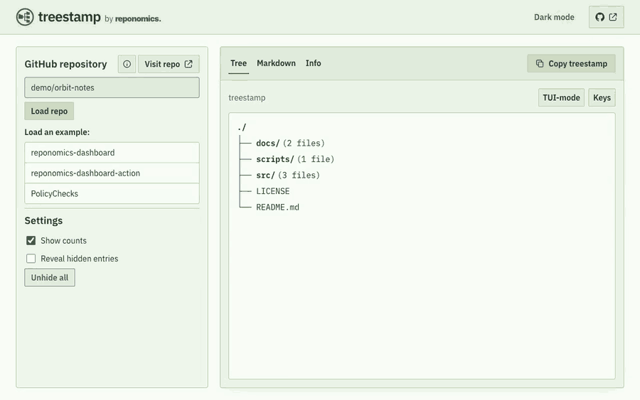

<div align="center">
    <picture>
        
    </picture>
</div>

<br>


[](https://www.bestpractices.dev/projects/15900)
[](https://www.bestpractices.dev/projects/15900)

[](https://github.com/reponomics/treestamp/actions/workflows/github-code-scanning/codeql)
[](https://github.com/reponomics/treestamp/actions/workflows/osv-scanner.yml)
[](https://codecov.io/gh/reponomics/treestamp)
[](https://github.com/reponomics/treestamp/actions/workflows/dependabot/dependabot-updates)


# treestamp

treestamp is an open source editor for creating and maintaining annotated directory trees for project documentation. It offers a few conveniences over manually drafting and updating file trees, or using `tree`. The interactive editor allows users to:

- select which files and folders to include via a visual interface.
- add brief annotations to rows in the file tree.
- reload the tree into the editor when it's time to update it.
- automatically detect when the displayed tree needs to be updated.
- easily maintain an SVG-based rendering of the tree.

The same core application is available in the terminal and in the hosted web editor.

<br>

<p align="center">

</p>


<p>
<h3 align="center">Try it now:</h3>
<h3 align="center"><a href="https://treestamp.reponomics.org">treestamp web editor</a></h3>
<h3 align="center">Or go straight to a specific project:</h3>
<h4 align="center"><code>https://treestamp.reponomics.org/USERNAME/REPO</code></h4>
</p>

<p><h3 align="center"><a href="#project-structure">See this repo's treestamp 🌲</a></h3></p>

## Quickstart

### 1. Generate a treestamp

#### In the browser

[Open the web editor](https://treestamp.reponomics.org/), enter a public GitHub repository URL (or `OWNER/REPONAME`), and choose **Create** for a new tree at its root. The server reads the repository's default branch. After editing the treestamp, copy it to your clipboard and paste it into your project's documentation.

#### In the terminal

treestamp is available on PyPI. It requires Python 3.11+ and Git, and is distributed with a Textual TUI for cross-platform support.

```bash
python -m pip install treestamp
treestamp
```

Homebrew users on macOS or Linux can install from the [Reponomics tap](https://github.com/reponomics/homebrew-tap). Homebrew manages Python, Git, and the application's dependencies:

```bash
brew install reponomics/tap/treestamp
treestamp
```

Invoke from anywhere within a Git repository. You can also run it directly without a persistent installation:

```
pipx run treestamp
```

For new users, `treestamp` opens the editor with a tree rooted at the current working directory. If you already have a treestamp at `./README.md`, it will load that document for editing. Use `treestamp new path/to/dir` to create a treestamp rooted in some other directory, or `treestamp load path/to/doc.md` to edit an existing treestamp located elsewhere.

> [!TIP]
> The terminal editor captures the Git index, so stage additions, deletions, and renames before opening it; untracked files and unstaged changes are not included.

### 2. Edit the tree

Use the editor to expand the important parts of the directory tree, hide the dotfiles or any other distractions, and add helpful notes.

**Terminal**



**Web Editor**



### 3. Add it to your README

When first writing a treestamp to a document, choose **Copy** in the terminal editor or **Copy Markdown** on the web, then paste the block into your project's Markdown document. treestamp renders directory trees inside a pair of HTML comment boundary markers:

`<!-- treestamp:start -->`

`<!-- treestamp:end -->`

These markers help the application recognize existing treestamps, and make sure that everything outside the boundaries stays the same.

Paste the whole block, including the markers, anywhere in your project's document.

````markdown
<!-- treestamp:start -->

```sh
./
├── docs/ (2 files)
├── src/  # Application code
│   ├── app.py
│   ├── search.py
│   └── storage.py
├── LICENSE
└── README.md
```

<!-- treestamp:end -->
````

#### SVG instead of a text block

You can export the treestamp in SVG format, and retain its structure for future editing. In the web editor, select the SVG output format. In the terminal, press `e` to save or copy SVG; `w` updates a loaded SVG in-place. SVG exports default to **Adaptive** appearance: one transparent image switches between black and white ink to match the embedding page’s light or dark color scheme. Fixed Light and Dark outputs are also available. The image carries an editable treestamp in its metadata, so it can be loaded again. Save it to a file in your repository, then add a link to it using Markdown image syntax. See [SVG export](https://github.com/reponomics/treestamp/blob/main/docs/cli-reference.md#svg-export) for the CLI and file-safety rules.

#### The config block

The treestamp may also contain a configuration comment after the top boundary marker. For example:

```html
<!-- treestamp:config
hidden = ["tests"]
-->
```

The `hidden` array records paths that are tracked in git, but that you wish to exclude from the rendered tree, so that when the treestamp is reloaded, the application can remember: "don't render these in the output." These hidden paths can always be viewed and unhidden in the editor interface.

### 4. Update an existing treestamp

To load an existing treestamp for editing, run `treestamp load path/to/doc.md`, or `treestamp load` for `./README.md`. The CLI path is relative to your current directory (absolute paths also work), and the document selects its containing repository. The editor will load the treestamp with the same editorial decisions (hidden paths, collapsed directories), and will attempt to update the draft if it has drifted from the repo's actual file structure:

(i) paths that are rendered in the tree but are no longer tracked in Git will be removed;

(ii) paths that are found in the git index but are not in the rendered tree will be added if they are children of a directory that is not collapsed. If the path is a directory, it will appear collapsed when first added.

**Transfer any displaced annotations**

If a file or folder that had annotations in the treestamp is moved or renamed, treestamp will ask you to reassign those notes from the old path to the new one. This allows you to preserve a file's annotation even as the project structure changes.

### Include a treestamp footer (optional)

We know that you will probably like this software, and you may be eager to tell others about it as well. To include an attribution footer, select **Add “Maintained with treestamp” footer** (or press <kbd>t</kbd> in the terminal). When enabled, the following line appears below the rendered tree and before the closing boundary marker:

```markdown
Maintained with [treestamp](https://github.com/reponomics/treestamp)
```

## Check your README automatically

treestamp can help you keep your documentation up to date. `treestamp check` compares the treestamp with the staged directory structure (the Git index) and exits 1 when an update would change the document. With no document argument, it checks `README.md` in your current directory; an explicit document path is also relative to that directory, or absolute. Add it as a pre-commit hook, and you can be notified whenever the treestamp has drifted from the state of the repo. treestamp can automatically update the tree, but we recommend that if you wish to follow this method, use the automation as a drift checker, and then open the editor to update the treestamp according to your preferences.

**GitHub Actions:** after checking out your repository and setting up Python 3.11+, add this step:

<!-- x-release-please-start-version -->
```yaml
- name: Check the README tree
  run: |
    python -m pip install "treestamp==2.0.0"
    treestamp check README.md
```
<!-- x-release-please-end -->

**Local pre-commit:** add this to `.pre-commit-config.yaml`, then run `pre-commit install`:

<!-- x-release-please-start-version -->
```yaml
repos:
  - repo: https://github.com/reponomics/treestamp
    rev: v2.0.0
    hooks:
      - id: treestamp-check
```
<!-- x-release-please-end -->


<details>
<summary>Windows</summary>

Use a terminal and font that display Unicode tree characters, or choose ASCII output. Treestamp emits UTF-8. New output uses LF line endings; printing a loaded region or writing into an existing document preserves its LF or CRLF convention. Windows filesystem restrictions still apply. See [CONTRIBUTING](https://github.com/reponomics/treestamp/blob/main/.github/CONTRIBUTING.md) for development setup.

</details>

## Technical details

Textual treestamps use fenced Unicode or ASCII branches.

The editor has to define a reserved sequence to be the delimiter between a filename and the annotation that follows it. In this case, it's `  # ` (space-space-hash-space). The problem is: this sequence is legal within a filename. This creates the potential for ambiguity for the parser. To avoid this, and maintain support for these uncommon filenames, pathnames whose final segment contains that sequence are stored in the config block in a `special_paths` array (see [special-path-resolution](https://github.com/reponomics/treestamp/blob/main/docs/special-path-resolution.md)).

The same exact-path registrations protect filenames containing ` -> ` or ending in ` [gitlink]`, so an ordinary file cannot be confused with a symlink or Git-link entry. The registration rule applies to every entry kind and output style.

Trailing whitespace in filenames and symlink targets is emitted as visible escape sequences so a formatter does not trim it away. Preserve those sequences when editing a document. Rendering fails if parsing the result would change the tree's identity or facts.

When a loaded treestamp has notes whose rows disappeared, the terminal and web editors offer to transfer them before ordinary editing. One source stays at the top while you navigate the updated tree: Enter places it, <kbd>s</kbd> skips it, and <kbd>u</kbd> undoes the last decision. Placing a directory also carries annotations at matching relative paths inside it, recursively; unmatched or conflicting descendants remain in the queue. Declining placement or skipping annotations leaves them out of the written tree. Placement is a one-time preparation step; restoring a saved web draft opens the editor directly. The CLI's `check` and `update` commands retain annotations at matching paths with the same entry kind; renamed paths require manual transfer. `update` refuses to write if notes would still be omitted; use `--skip-notes-transfer` only when you explicitly want to leave those notes out. `check` reports the proposed changes and unmatched notes without writing. `treestamp load DOCUMENT --print` extracts the saved treestamp without updating it or checking for note transfer.

treestamp's ability to track changes when updating a document and comparing it to a new checkout depends on preserving the generated tree and configuration between its boundary markers. Manual edits to annotations are supported. Other changes to the tree or configuration should be made through the editor so treestamp can reliably reload the document.

New output includes a blank line after the start marker, between the configuration comment (when present) and the tree, and before the end marker. `treestamp check` accepts either zero or one blank line at each of these boundaries, independently. The terminal and web editors preserve this spacing when loading and exporting an existing treestamp; writes and `treestamp update` preserve the destination document's spacing and line endings. Newly created documents use the default blank lines. This allows Markdown formatters to adjust these boundaries without making an otherwise current tree fail its check.

Configuration arrays use compact wrapping with an 80-character target: short arrays stay inline, and longer arrays fit several entries per line where possible. Individual entries are never split, so a long path or record may exceed the target. Existing UTF-8 TOML formatting, including comments and multiline arrays, is preserved while the configuration values remain unchanged and does not cause `check` to fail. When those values change, or retained configuration text contains non-UTF-8 bytes, the configuration is regenerated using the default layout; comments within that configuration are not retained. Both editors apply this normalization without changing configuration values or surrounding Markdown bytes. The configuration must still use supported settings and valid values inside the `treestamp:config` comment wrapper.

The [document format reference](https://github.com/reponomics/treestamp/blob/main/docs/design.md#document-format) describes the current formatting rules.

## Project Structure

<!-- treestamp:start -->
<!-- treestamp:config
hidden = [
    ".dockerignore", ".github/.release-please-manifest.json",
    ".github/CODEOWNERS", ".github/CODE_OF_CONDUCT.md",
    ".github/CONTRIBUTING.md", ".github/DCO.txt", ".github/ISSUE_TEMPLATE",
    ".github/PULL_REQUEST_TEMPLATE.md", ".github/SECURITY.md",
    ".github/dependabot.yml", ".github/release-please-config.json",
    ".gitignore", ".nvmrc", ".pre-commit-config.yaml", ".pre-commit-hooks.yaml",
    ".python-version", ".tool-versions", "CHANGELOG.md", "LICENSE", "Makefile",
    "PRIVACY.md", "README.treestamp.svg", "codecov.yml", "docs/GOVERNANCE.md",
    "docs/MAINTENANCE.md", "docs/ROADMAP.md", "docs/cli-reference.md",
    "docs/design.md", "docs/homebrew-tap.md", "docs/security-assessment.md",
    "docs/special-path-resolution.md", "docs/testing.md", "docs/ui-flow.md",
    "docs/ui-patterns.md", "docs/ui-review.md", "docs/verifying-releases.md",
    "osv-scanner.toml", "pyproject.toml", "uv.lock", "vex", "web/Dockerfile",
    "web/README.md", "web/fly.preview.toml", "web/fly.toml", "web/package.json",
    "web/pyproject.toml",
]
-->
```sh
./
├── .github/  # GitHub Actions workflows and community docs
│   └── workflows/ (10 files)
├── assets/ (2 files, 1 folder)
├── docs/  # Project documentation
│   ├── adr/ (5 files)
│   └── planning/ (2 files)
├── scripts/ (10 files, 1 folder)  # Installed-package acceptance
├── src/
│   └── treestamp/ (25 files)  # Shared model and terminal editor
├── tests/ (42 files)  # Contract and integration tests
├── web/  # Hosted editor: a FastAPI adapter over the same package
│   ├── scripts/ (4 files)
│   ├── src/
│   │   └── treestamp_web/ (15 files, 2 folders)
│   └── tests/ (25 files, 2 folders)
└── README.md
```

Maintained with [treestamp](https://github.com/reponomics/treestamp)
<!-- treestamp:end -->

The alternate styles below are generated from the same tree and checked for freshness in CI.

<!-- readme-styles:start -->
<details>
<summary>View ASCII style</summary>

```sh
./
|-- .github/  # GitHub Actions workflows and community docs
|   `-- workflows/ (10 files)
|-- assets/ (2 files, 1 folder)
|-- docs/  # Project documentation
|   |-- adr/ (5 files)
|   `-- planning/ (2 files)
|-- scripts/ (10 files, 1 folder)  # Installed-package acceptance
|-- src/
|   `-- treestamp/ (25 files)  # Shared model and terminal editor
|-- tests/ (42 files)  # Contract and integration tests
|-- web/  # Hosted editor: a FastAPI adapter over the same package
|   |-- scripts/ (4 files)
|   |-- src/
|   |   `-- treestamp_web/ (15 files, 2 folders)
|   `-- tests/ (25 files, 2 folders)
`-- README.md
```

Maintained with [treestamp](https://github.com/reponomics/treestamp)

</details>
<!-- readme-styles:end -->

<details>
<summary>View SVG style</summary>
<picture>

</picture>
</details>

## Development and support

[Contributing](https://github.com/reponomics/treestamp/blob/main/.github/CONTRIBUTING.md) · [Testing](https://github.com/reponomics/treestamp/blob/main/docs/testing.md) · [Maintenance](https://github.com/reponomics/treestamp/blob/main/docs/MAINTENANCE.md) · [Governance](https://github.com/reponomics/treestamp/blob/main/docs/GOVERNANCE.md) · [Design](https://github.com/reponomics/treestamp/blob/main/docs/design.md) · [Roadmap](https://github.com/reponomics/treestamp/blob/main/docs/ROADMAP.md) · [Security assessment](https://github.com/reponomics/treestamp/blob/main/docs/security-assessment.md) · [Verifying releases](https://github.com/reponomics/treestamp/blob/main/docs/verifying-releases.md) · [Changelog](https://github.com/reponomics/treestamp/blob/main/CHANGELOG.md) · [Privacy](https://github.com/reponomics/treestamp/blob/main/PRIVACY.md)

Report bugs through [GitHub issues](https://github.com/reponomics/treestamp/issues), vulnerabilities through [private security reporting](https://github.com/reponomics/treestamp/security/advisories/new), and conduct concerns to [conduct@reponomics.org](mailto:conduct@reponomics.org).

[MIT licensed](https://github.com/reponomics/treestamp/blob/main/LICENSE).
