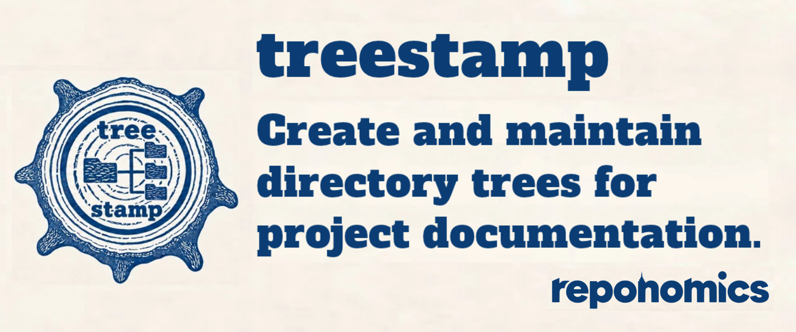
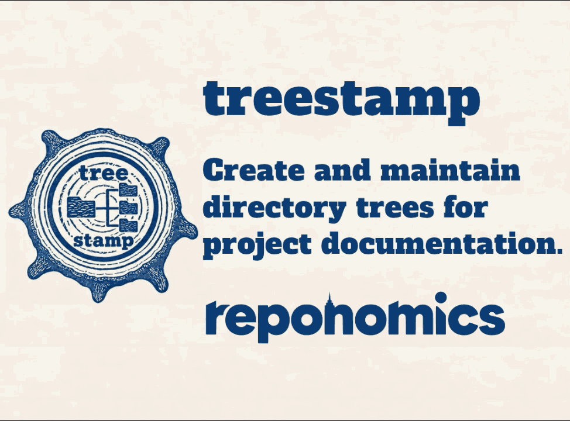
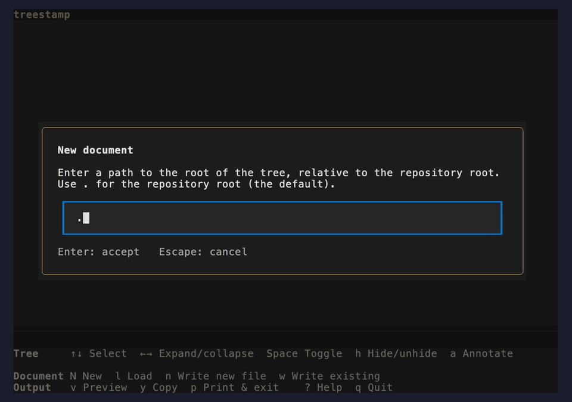
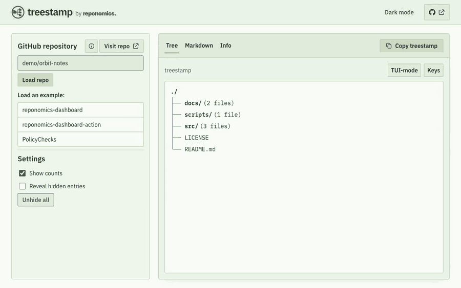

<div align="center">
    <picture>
        
    </picture>
</div>

<br>


[](https://www.bestpractices.dev/projects/15900)
[](https://www.bestpractices.dev/projects/15900)

[](https://github.com/reponomics/treestamp/actions/workflows/github-code-scanning/codeql)
[](https://github.com/reponomics/treestamp/actions/workflows/osv-scanner.yml)
[](https://codecov.io/gh/reponomics/treestamp)
[](https://github.com/reponomics/treestamp/actions/workflows/dependabot/dependabot-updates)


# treestamp

treestamp is an editor for creating and maintaining directory trees for project documentation. Easily select which files and folders to include, and add brief annotations. The application reloads your treestamp when you want to update it, and automated checks can notify you when there is any drift between treestamp and the repository, making it easy to keep documentation up to date.


<p align="center">

</p>


<p>
<h3 align="center">Try it now:</h3>
<h3 align="center"><a href="https://treestamp.reponomics.org">treestamp web editor</a></h3>
<h3 align="center">Or go straight to a specific project:</h3>
<h4 align="center"><code>https://treestamp.reponomics.org/USERNAME/REPO</code></h4>
</p>

<p><h3 align="center"><a href="#project-structure">See this repo's treestamp 🌲</a></h3></p>


## Quickstart

### 1. Generate a treestamp

treestamp can be accessed locally in your terminal, or online via the web editor.

#### In the browser

[Open the web editor](https://treestamp.reponomics.org/); enter a public GitHub repository URL (or `OWNER/REPONAME` form); and choose **Load repo → Create treestamp**. The server will fetch the directory structure of the repository at the HEAD of the default branch, and render a basic tree as a starting point.

#### In your terminal

treestamp is available on PyPI. It requires Python 3.11+ and Git, and is distributed with a Textual TUI for cross-platform support.

```bash
python -m pip install treestamp
treestamp
```

Homebrew users on macOS or Linux can install from the [Reponomics tap](https://github.com/reponomics/homebrew-tap). Homebrew manages Python, Git, and the application's dependencies:

```bash
brew install reponomics/tap/treestamp
```

Invoke it directly from anywhere within a Git repository. You can also run it directly without a persistent installation:

```
pipx run treestamp
```

Choose **New document** and select the path where you want the root of the repository tree to be located (defaults to the repository root, `.`, but you can generate a treestamp for any sub-tree in the repository) - the treestamp root is a relative path from the repository's root.

> [!NOTE]
> Tree-root and document paths entered in the editor, and paths stored in its configuration, are relative to the _repository root_. Entries in the rendered tree are relative to the selected subtree.

> [!TIP]
> The terminal editor captures the Git index, so stage additions, deletions, and renames before opening it; untracked files and unstaged changes are not included. The web editor reads the pushed state of the repository's default branch.

### 2. Edit the tree

Use the editor to expand the important parts of the directory tree, hide the dotfiles or any other distractions, and add helpful notes.

**Terminal**



**Web Editor**



### 3. Add it to your README

When first writing a treestamp to a document, choose **Copy** in the terminal editor or **Copy treestamp** on the web, then paste the block into your project's Markdown document. treestamp renders directory trees inside a pair of HTML comment boundary markers:

`<!-- treestamp:start -->`

`<!-- treestamp:end -->`

These markers help the application recognize existing treestamps, and make sure that everything outside the boundaries stays the same.

Paste the whole block, including the markers, anywhere in your project's document (the web editor does not perform any writes to GitHub).

````markdown
<!-- treestamp:start -->

```sh
./
├── docs/ (2 files)
├── src/  # Application code
│   ├── app.py
│   ├── search.py
│   └── storage.py
├── LICENSE
└── README.md
```

<!-- treestamp:end -->
````

#### The config block

The treestamp may also contain a configuration comment after the top boundary marker. It opens with `<!-- treestamp:config`, contains TOML settings, and closes with `-->` on a separate line. For example:

```html
<!-- treestamp:config
hidden = ["tests"]
-->
```

The `hidden` array records paths that the user has elected to hide, so that when the treestamp is reloaded, the application can remember: "don't render these in the output." These hidden paths can always be viewed and unhidden in the editor interface.

<details>
<summary>Alternate bootstrapping method</summary>

Another way to write the initial treestamp is to simply place the boundary markers into the target document, like so:


```html
<!-- treestamp:start -->
<!-- treestamp:end -->
```

In the terminal editor, choose **New document**, select the tree root, and edit the tree. When you are ready, choose **Write to existing** and enter the path to the document containing those markers. The application fills the marked region by writing to that file and preserves the surrounding content.

</details>

### 4. Update an existing treestamp

To load an existing treestamp for editing, enter the path to its document in the editor interface, or run `treestamp --load docs/structure.md` to open it directly. The CLI path is relative to your current directory (absolute paths also work), and the document selects its containing repository. The editor will find the boundary markers and load the treestamp with the same editorial decisions (hidden paths, collapsed directories, etc.). However, the following modifications will be applied to the draft when loaded into the editor:

(i) paths that are rendered in the tree but are no longer tracked in Git will be removed from the draft;

(ii) new tracked entries (files and folders) will be added if they appear beneath already-expanded directories, including the tree root. Entries beneath collapsed directories remain unexpanded, and newly added directories start collapsed.

The application is designed to help keep documentation up to date by removing stale paths, which positively misrepresent the state of the repository; add new paths when they appear, but in a conservative manner; and preserve the user's previous edits and decisions, as best as possible.

### Include a treestamp footer (optional)

treestamp is a very cool software, and you will probably want to let other people know that you're using it. Of course, you don't have to (we understand that sometimes it's cooler to keep things a secret), but if you want to include a small recognition in the footer of your treestamp, you can opt in to doing so by selecting **Add “Maintained with treestamp” footer** (or press <kbd>t</kbd> in the terminal). This will simply print the following line below the rendered tree, and before the closing boundary marker:

```markdown
Maintained with [treestamp](https://github.com/reponomics/treestamp)
```

## Check your README automatically

treestamp can help you keep your documentation up to date. `treestamp check` compares the treestamp with the staged directory structure (the Git index), or the revision selected with `--target REF`, and exits 1 when an update would change the document. With no document argument, it checks the repository-root README; an explicit document path is relative to your current directory. Add it as a pre-commit hook, and you can be notified whenever the treestamp has drifted from the state of the repo. treestamp can automatically update the tree, but we recommend that if you wish to follow this method, use the automation as a drift checker, and then open the editor to update the treestamp according to your preferences.

**GitHub Actions:** after checking out your repository and setting up Python 3.11+, add this step:

<!-- x-release-please-start-version -->
```yaml
- name: Check the README tree
  run: |
    python -m pip install "treestamp==1.0.1"
    treestamp check README.md
```
<!-- x-release-please-end -->

**Local pre-commit:** add this to `.pre-commit-config.yaml`, then run `pre-commit install`:

<!-- x-release-please-start-version -->
```yaml
repos:
  - repo: https://github.com/reponomics/treestamp
    rev: v1.0.1
    hooks:
      - id: treestamp-check
```
<!-- x-release-please-end -->


<details>
<summary>Windows</summary>

Use a terminal and font that display Unicode tree characters, or choose ASCII output. Treestamp emits UTF-8. New output uses LF line endings; printing a loaded region or writing into an existing document preserves its LF or CRLF convention. Windows filesystem restrictions still apply. See [CONTRIBUTING](https://github.com/reponomics/treestamp/blob/main/.github/CONTRIBUTING.md) for development setup.

</details>

## Limitations and edge cases

The editor has to define a reserved sequence to be the delimiter between a filename and the annotation that follows it. In this case, it's `  # ` (space-space-hash-space). The problem is: this sequence is legal within a filename. This creates the potential for ambiguity for the parser. To avoid this, and maintain support for these uncommon filenames, pathnames that end in a segment that contains that sequence are stored in the config block in a `special_paths` array (see [special-path-resolution](https://github.com/reponomics/treestamp/blob/main/docs/special-path-resolution.md)).

Currently, there is also the potential for a treestamp to be corrupted if it contains filenames that have trailing whitespace, and this whitespace is truncated or edited by some automation such as a linter.

The TUI and web editor do not currently detect moves or renames, so annotations on moved entries may be dropped when a document is loaded. The CLI's `check` and `update` commands can preserve annotations for supported Git-detected file moves when supplied with `--compare REF`; this does not transfer directory annotations.

treestamp's ability to track changes when updating a document and comparing it to a new checkout depends on preserving the generated tree and configuration between its boundary markers. Manual edits to annotations are supported. Other changes to the tree or configuration should be made through the editor so treestamp can reliably reload the document.

New output includes a blank line after the start marker, between the configuration comment (when present) and the tree, and before the end marker. `treestamp check` accepts either zero or one blank line at each of these boundaries, independently. The terminal and web editors preserve this spacing when loading and exporting an existing treestamp; writes and `treestamp update` preserve the destination document's spacing and line endings. Newly created documents use the default blank lines. This allows Markdown formatters to adjust these boundaries without making an otherwise current tree fail its check.

Configuration arrays use compact wrapping with an 80-character target: short arrays stay inline, and longer arrays fit several entries per line where possible. Individual entries are never split, so a long path or record may exceed the target. Existing TOML formatting, including comments and multiline arrays, is preserved while the configuration values remain unchanged and does not cause `check` to fail. When those values change, the configuration is regenerated using the default layout; comments within that configuration are not retained. The configuration must still use supported settings and valid values inside the `treestamp:config` comment wrapper.

[ADR 0002](https://github.com/reponomics/treestamp/blob/main/docs/adr/0002-formatter-compatible-documents.md) explains the formatting decisions, alternatives, and implementation.

## Project Structure

<!-- treestamp:start -->
<!-- treestamp:config
hidden = [".dockerignore", ".gitignore", ".nvmrc", ".pre-commit-config.yaml", ".pre-commit-hooks.yaml", ".python-version", ".tool-versions", "CHANGELOG.md", "LICENSE", "Makefile", "PRIVACY.md", "codecov.yml", "osv-scanner.toml", "pyproject.toml", "src/treestamp/__init__.py", "src/treestamp/__main__.py", "src/treestamp/py.typed", "uv.lock", "vex"]
-->
```sh
./
├── .github/ (9 files, 2 folders)
├── assets/ (2 files, 1 folder)
├── docs/ (10 files, 1 folder)
├── scripts/ (9 files)  # Installed-package acceptance
├── src/
│   └── treestamp/  # Shared model and terminal editor
│       ├── cli.py
│       ├── codec.py
│       ├── document.py
│       ├── editor.py
│       ├── errors.py
│       ├── gitio.py
│       ├── maintenance.py
│       ├── model.py
│       ├── session.py
│       ├── sources.py
│       ├── tui.py
│       └── tui_dialogs.py
├── tests/ (19 files)  # Contract and integration tests
├── web/  # Hosted editor: a FastAPI adapter over the same package
│   ├── scripts/ (3 files)
│   ├── src/ (1 folder)
│   ├── tests/ (14 files, 2 folders)
│   ├── Dockerfile
│   ├── README.md
│   ├── fly.preview.toml
│   ├── fly.toml
│   ├── package.json
│   └── pyproject.toml
└── README.md
```

Maintained with [treestamp](https://github.com/reponomics/treestamp)
<!-- treestamp:end -->

The alternate styles below are generated from the same tree and checked for freshness in CI.

<!-- readme-styles:start -->
<details>
<summary>View ASCII style</summary>

```sh
./
|-- .github/ (9 files, 2 folders)
|-- assets/ (2 files, 1 folder)
|-- docs/ (10 files, 1 folder)
|-- scripts/ (9 files)  # Installed-package acceptance
|-- src/
|   `-- treestamp/  # Shared model and terminal editor
|       |-- cli.py
|       |-- codec.py
|       |-- document.py
|       |-- editor.py
|       |-- errors.py
|       |-- gitio.py
|       |-- maintenance.py
|       |-- model.py
|       |-- session.py
|       |-- sources.py
|       |-- tui.py
|       `-- tui_dialogs.py
|-- tests/ (19 files)  # Contract and integration tests
|-- web/  # Hosted editor: a FastAPI adapter over the same package
|   |-- scripts/ (3 files)
|   |-- src/ (1 folder)
|   |-- tests/ (14 files, 2 folders)
|   |-- Dockerfile
|   |-- README.md
|   |-- fly.preview.toml
|   |-- fly.toml
|   |-- package.json
|   `-- pyproject.toml
`-- README.md
```

Maintained with [treestamp](https://github.com/reponomics/treestamp)

</details>

<details>
<summary>View list style</summary>

./

- .github/ (9 files, 2 folders)
- assets/ (2 files, 1 folder)
- docs/ (10 files, 1 folder)
- scripts/ (9 files)  # Installed-package acceptance
- src/
  - treestamp/  # Shared model and terminal editor
    - cli.py
    - codec.py
    - document.py
    - editor.py
    - errors.py
    - gitio.py
    - maintenance.py
    - model.py
    - session.py
    - sources.py
    - tui.py
    - tui_dialogs.py
- tests/ (19 files)  # Contract and integration tests
- web/  # Hosted editor: a FastAPI adapter over the same package
  - scripts/ (3 files)
  - src/ (1 folder)
  - tests/ (14 files, 2 folders)
  - Dockerfile
  - README.md
  - fly.preview.toml
  - fly.toml
  - package.json
  - pyproject.toml
- README.md

Maintained with [treestamp](https://github.com/reponomics/treestamp)

</details>
<!-- readme-styles:end -->

## Development and support

[Contributing](https://github.com/reponomics/treestamp/blob/main/.github/CONTRIBUTING.md) · [Testing](https://github.com/reponomics/treestamp/blob/main/docs/testing.md) · [Maintenance](https://github.com/reponomics/treestamp/blob/main/docs/MAINTENANCE.md) · [Governance](https://github.com/reponomics/treestamp/blob/main/docs/GOVERNANCE.md) · [Design](https://github.com/reponomics/treestamp/blob/main/docs/design.md) · [Roadmap](https://github.com/reponomics/treestamp/blob/main/docs/ROADMAP.md) · [Security assessment](https://github.com/reponomics/treestamp/blob/main/docs/security-assessment.md) · [Verifying releases](https://github.com/reponomics/treestamp/blob/main/docs/verifying-releases.md) · [Changelog](https://github.com/reponomics/treestamp/blob/main/CHANGELOG.md) · [Privacy](https://github.com/reponomics/treestamp/blob/main/PRIVACY.md)

Report bugs through [GitHub issues](https://github.com/reponomics/treestamp/issues), vulnerabilities through [private security reporting](https://github.com/reponomics/treestamp/security/advisories/new), and conduct concerns to [conduct@reponomics.org](mailto:conduct@reponomics.org).

[MIT licensed](https://github.com/reponomics/treestamp/blob/main/LICENSE).
