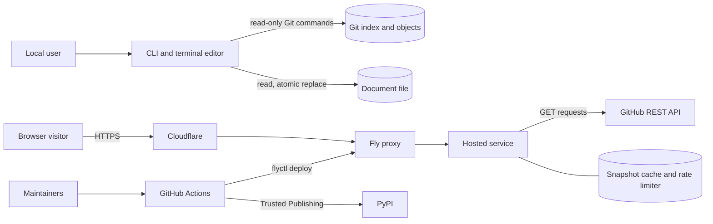

# Design overview

Treestamp produces a curated directory tree from Git facts and stores it between two HTML comment markers in a Markdown document. The same core package backs a terminal editor, headless `check` and `update` commands, pre-commit hooks, and a hosted web editor for public GitHub repositories. This document describes the components, the actors that act on them, and the boundaries between them. For the external interfaces themselves, see [interfaces.md](interfaces.md).

## Components

| Component | Location | Role |
| --- | --- | --- |
| Core package | [`src/treestamp/`](../src/treestamp/) | Tree model and validation (`model.py`), printing and parsing rows (`codec.py`), document regions and atomic writes (`document.py`), Git adapter (`gitio.py`), tree records from non-Git sources (`sources.py`), update logic (`maintenance.py`), editing session state (`session.py`, `editor.py`). Distributed on PyPI as `treestamp`. |
| Command line | [`cli.py`](../src/treestamp/cli.py) | Dispatches to the terminal editor, `--print`, `check`, or `update`; maps failures to exit codes. |
| Terminal editor | [`tui.py`](../src/treestamp/tui.py), [`tui_dialogs.py`](../src/treestamp/tui_dialogs.py) | Textual application over an `EditorController`. Loads, curates, previews, copies, and writes documents. |
| Pre-commit hooks | [`.pre-commit-hooks.yaml`](../.pre-commit-hooks.yaml) | `treestamp` runs `treestamp update`; `treestamp-check` runs `treestamp check`. |
| Hosted service | [`web/src/treestamp_web/`](../web/src/treestamp_web/) | FastAPI application (`app.py`) with a GitHub REST client (`github.py`), request parsing and rendering (`preview.py`), snapshot cache (`cache.py`), per-client rate limiter (`limits.py`), proxy-header handling (`proxy.py`), and Fly session routing (`routing.py`). Shipped as a container image, not on PyPI. |
| Browser frontend | [`web/src/treestamp_web/static/`](../web/src/treestamp_web/static/) | Static page and JavaScript (`app.js`, `logic.js`, `example.js`, `theme.js`). Holds the draft in page memory and the URL fragment and calls the service's JSON API. |
| Delivery pipeline | [`.github/workflows/`](../.github/workflows/), [`.github/dependabot.yml`](../.github/dependabot.yml), [`web/Dockerfile`](../web/Dockerfile), [`web/fly.toml`](../web/fly.toml) | CI, README tree maintenance, Release Please, PyPI publication, production deployment to Fly.io, dependency scanning and updates. |

## Actors and actions

| Actor | Acts on | Actions and data |
| --- | --- | --- |
| Local user | Terminal editor, CLI, document | Runs commands, selects a tree root or document, hides entries, annotates, writes or copies the result. Stages source changes with Git; Treestamp itself never stages. |
| CLI and terminal editor process | Git, filesystem, stdout, clipboard | Runs `git rev-parse`, `write-tree`, `ls-tree`, `cat-file --batch`, `ls-files --stage`, and `diff --find-renames` with a 60-second timeout and a 64 MiB output cap. Reads the document; writes it only for `update`, Write to existing, or Write new file. Prints to stdout. Copies through `pbcopy`, `clip`, `wl-copy`, `xclip`, or `xsel` when present, otherwise through the terminal's clipboard escape sequence. |
| Git repository | CLI | Supplies the tree of the index (default) or of a named ref, symlink targets, submodule entries, and rename pairs. Reading the index runs `git write-tree`, which records the index's tree object in the object database; no command changes the index, HEAD, refs, or the working tree. |
| Filesystem | CLI | Holds documents. Document paths must stay inside the repository, contain no symbolic link components, and not cross into a nested repository or submodule. Writes go to a temporary file in the same directory, then replace the document atomically after a second conflict check. |
| pre-commit or CI runner | CLI | Invokes `check` or `update` in a checkout; `check` exit status gates the commit or job. |
| Browser visitor | Page, hosted service | Loads the static page; sends `/api/preview` and `/api/op` requests; keeps the draft in page memory and the `#s=` URL fragment; stores the theme choice in `localStorage`; copies the treestamp through the Clipboard API. Bundled examples render from `example.js` without a request. |
| Hosted service | GitHub REST API, cache, visitor | Validates requests, applies rate limits, reads public repository facts from GitHub, retains snapshots in memory, renders trees with the core package, and returns JSON. It issues only GET requests against repository endpoints and never writes to GitHub. It has no visitor accounts and does not access visitors' GitHub accounts. |
| GitHub REST API | Hosted service | Returns repository metadata (numeric id, visibility, default branch), commit and tree ids, recursive tree listings, and raw blobs (documents and symlink targets). Issues installation tokens for the service's GitHub App. Rate limit headers feed the service's request budget. |
| Service credential | GitHub REST API | Either `GITHUB_TOKEN` or a GitHub App (`GITHUB_APP_CLIENT_ID`, `GITHUB_APP_INSTALLATION_ID`, `GITHUB_APP_PRIVATE_KEY`), stored as Fly secrets. The App key signs a short-lived RS256 JWT that is exchanged for an installation token, refreshed five minutes before expiry or after a 401. This credential is separate from the release App. |
| Snapshot cache | Hosted service | Per-process memory keyed by owner, repository, and commit. Retains tree records and fetched blobs for one hour after a successful load; reads do not extend that. Evicts by count and size limits, and discards snapshots when an owner/name now refers to a different repository id. `/api/op` succeeds only against a snapshot in this cache or a bundled example. |
| Rate limiter | Hosted service | Per-process token buckets keyed by client address: one for loads, one for editing operations. Nothing is persisted. |
| Fly.io | Hosted service | Builds and runs the container as a non-root user on two Machines, terminates TLS for the custom domain, health-checks `/healthz`, supplies `Fly-Client-IP` and `FLY_MACHINE_ID`, holds secrets, and honours `Fly-Replay` responses that route a browser session back to the Machine holding its snapshot. |
| Cloudflare | Visitor traffic | Serves DNS for `treestamp.reponomics.org` and, with proxying enabled, sits in front of Fly and supplies `CF-Connecting-IP`. The service accepts that header only from configured Cloudflare ranges (see [MAINTENANCE.md](../MAINTENANCE.md#production-deployment)). |
| GitHub Actions | Repository, PyPI, Fly | Runs the workflows listed below with job-scoped tokens. |
| Release Please | Repository | Through the release GitHub App, opens release PRs, updates versions and `CHANGELOG.md`, and creates tags and GitHub Releases. |
| PyPI | Package users | Receives wheel and source distributions with attestations through Trusted Publishing; no stored upload token. |
| Dependabot | Repository | Opens weekly update PRs for the uv lock, the Docker base image, and GitHub Actions. |
| Maintainers | Repository, GitHub settings, Fly, Cloudflare | Review and merge PRs, approve protected environments, configure variables and secrets, set Fly secrets, run manual deployments, and manage DNS. |

## Local flow

`check` and `update` resolve the repository from the current directory, read the document, and parse its region. They capture a target tree from the index (or `--target REF`), refuse a tree that cannot be printed without loss, refresh the printed tree against it, and render the region. `check` compares the resulting bytes with the document and prints a diff; `update` publishes them. Bytes outside the marker pair are not changed, and the region keeps the document's line endings.

The terminal editor starts with no source and asks for New document (a tree root) or Load document. Each load captures a fixed snapshot of the index; it is prepared completely before it replaces the current draft, so a failed load leaves the draft intact. Write to existing refuses to overwrite a document that changed since the session loaded or wrote it. Quitting with unwritten changes asks for confirmation.

## Hosted flow

1. The browser sends a load request with a repository link or owner and name, a tree root, and a document path.
2. The service fetches repository metadata and requires `private: false` and `visibility: public`, then resolves the default branch to a commit and tree and fetches the recursive listing. Branches and tags in links are not followed; only the default branch or an already-cached commit is accepted.
3. If the document exists in the snapshot, the service fetches it (up to 1 MiB) and parses its region; otherwise it starts a new tree. Symlink targets beneath the root are fetched as blobs, up to a configured count.
4. The service renders the tree and returns rows, the complete treestamp, a permalink, and a session envelope (curation state, source identity, base64 document region, and a revision counter). It then stores the snapshot in the cache.
5. Each edit sends the envelope and one operation to `/api/op`. The service checks that the envelope's source matches the request, rebuilds the session against the cached snapshot, applies the operation, and returns a new envelope. The envelope is client-held state: it is validated on every request and grants nothing beyond the cached snapshot it names.
6. The visitor copies the treestamp from the page. Nothing is sent to GitHub.

When session routing is enabled, a successful load sets the `__Host-treestamp-machine` cookie to the serving Machine's id. Later API requests that arrive at another Machine receive a `Fly-Replay` response directing Fly to the owning Machine, with fallback to local handling. If the snapshot is gone (expiry, restart, or deployment), the service returns `410 snapshot_unavailable` and the page keeps the current draft copyable.

The service writes one JSON log line per load, operation, or rejection, containing the repository, commit, root, operation type, status, GitHub call count, and duration. These records do not include the client address; Uvicorn's access log, which is enabled, records request lines and the connection's peer address. See [PRIVACY.md](../PRIVACY.md).

## Delivery pipeline

| Workflow | Trigger | Credentials and permissions | Effect |
| --- | --- | --- | --- |
| [`ci.yml`](../.github/workflows/ci.yml) | Push to `main`, PRs, manual | `contents: read` | Linux and Windows regression suites, hosted-editor gates and browser tests, distribution and hook checks, container build and health probe. |
| [`treestamp-check.yml`](../.github/workflows/treestamp-check.yml) | Push to `main`, PRs, manual | `contents: read` | Runs `treestamp check README.md` against the candidate revision. |
| [`treestamp-update.yml`](../.github/workflows/treestamp-update.yml) | Failed check of a push to `main`, manual | `contents: write`, `pull-requests: write` | Runs `treestamp update README.md` on the trusted branch and opens or refreshes one draft PR. |
| [`semantic-pr.yml`](../.github/workflows/semantic-pr.yml) | `pull_request_target` | `pull-requests: read` | Validates the PR title from metadata; does not check out PR code. |
| [`release-please.yml`](../.github/workflows/release-please.yml) | Push to `main`, manual | Release App token: contents, issues, pull requests write | Maintains the release PR; after it merges, creates the tag and GitHub Release. |
| [`publish.yml`](../.github/workflows/publish.yml) | Published GitHub Release | Build job `contents: read`; publish job `id-token: write` in the `pypi` environment | Validates tag, versions, and ancestry on `main`; runs checks; builds; uploads with attestations. The publish job runs no project code. |
| [`deploy.yml`](../.github/workflows/deploy.yml) | Push to `main`, manual with a revision | `contents: read`; `FLY_API_TOKEN` in the `production` environment | Skips an obsolete push, deploys with `flyctl` using a rolling strategy, and verifies `build_commit` on the public `/healthz`. |
| [`osv-scanner.yml`](../.github/workflows/osv-scanner.yml) | Push to `main`, weekly, manual | `security-events: write` | Scans `uv.lock`; uploads SARIF when the repository is public. |
| [`scorecard.yml`](../.github/workflows/scorecard.yml) | Push to `main`, weekly, branch protection changes, manual | `security-events: write`, `id-token: write` | Supply-chain analysis on the public default branch. |

All third-party actions are pinned to commit SHAs, and checkouts do not persist credentials. The container image pins its base images by digest and installs dependencies from `uv.lock`. Repository settings, required checks, environments, and external setup are described in [MAINTENANCE.md](../MAINTENANCE.md).

## Trust boundaries

- Repository content is input. File names, symlink targets, and document text are validated, escaped onto a single line, and parsed back before any output is written or copied. Entries that cannot be represented exactly cause the load or write to fail rather than produce altered output.
- The local process runs with the user's privileges and acts only on the selected repository. Document paths are checked against the repository root, symbolic links, nested repositories, and submodules before each write.
- Everything the browser sends, including the session envelope and URL fragment, is untrusted. The service accepts editing operations only for snapshots it acquired from GitHub under the public default-branch policy, or for bundled examples.
- GitHub responses are checked for type, size, and truncation, and commit and tree identifiers for format. Redirects are not followed; a moved repository is reported as not found.
- Client addresses for rate limiting come from the socket peer unless proxy trust is configured. `CF-Connecting-IP` is accepted only when Fly's peer address is in the configured Cloudflare ranges.
- Pull-request workflows run with read-only tokens. Credentials that can publish or deploy are confined to `main`, release events, and protected environments.
